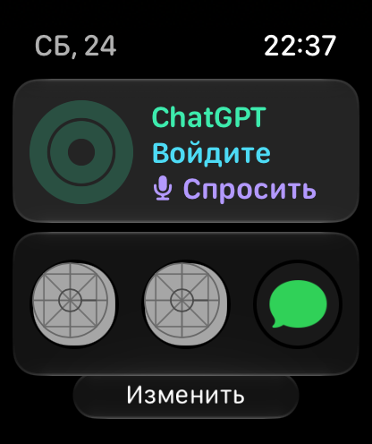
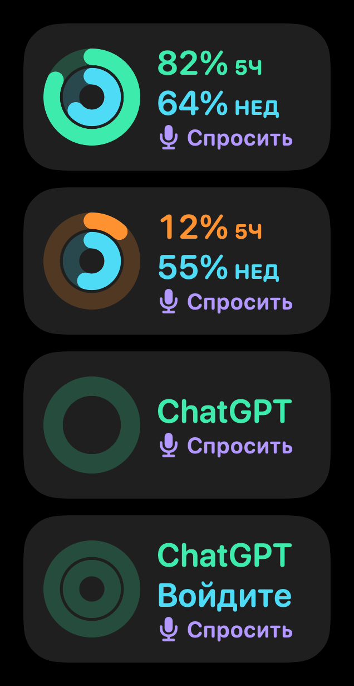

<div align="center">


# WatchGPT

**ChatGPT на Apple Watch по вашей подписке.**<br>
Без API-ключа и без приложения на iPhone: нажали, спросили, получили ответ.

[](https://github.com/ReNothingg/WatchGPT/actions/workflows/build.yml)


[](LICENSE)

[Возможности](#возможности) · [Установка](#установка) · [Как пользоваться](#как-пользоваться) · [Если что-то не работает](#если-что-то-не-работает)

</div>

> [!WARNING]
> Это **неофициальный** проект, он не связан с OpenAI. Приложение входит в ChatGPT так же, как
> [Codex CLI](https://github.com/openai/codex), и OpenAI может в любой момент это изменить.
> Тогда WatchGPT перестанет работать, пока его не обновят.

## Возможности

| | |
|---|---|
| 🎙 **Один тап до ответа** | Микрофон → говорите → ответ печатается в реальном времени, часы вибрируют, когда он готов |
| 🗣 **Точное распознавание** | Любые языки и их смесь, режим шёпота, формулы на слух: «икс в квадрате плюс два икс» → `x² + 2x` |
| ∑ **Формулы по-человечески** | `x₁,₂ = (−b ± √(b² − 4ac))/(2a)`, `∫₀¹ x² dx` вместо сырого LaTeX |
| 🔋 **Лимиты на виду** | Кольцо в углу и экран «Лимиты»: остаток в 5-часовом и недельном окне, график расхода по дням, уведомление о сбросе |
| 🧠 **Любая модель** | Список моделей и глубина рассуждений приходят с сервера ChatGPT; поиск в интернете, короткие ответы |
| ✳️ **Режим Claude** | Opus, Sonnet, Haiku и Fable по API-ключу Anthropic: список моделей с сервера, глубина рассуждений, поиск. Чаты Claude хранятся на часах |
| ↕️ **«Короче» / «Подробнее»** | Переспросить в одно касание, без диктовки |
| ⚡️ **Быстрые вопросы** | Свои шаблоны на главном экране: «Главные новости» уходит сразу, «Переведи на английский» ждёт продолжения голосом |
| 🔄 **История ChatGPT** | Чаты вашего аккаунта прямо на часах: читайте и продолжайте голосом |
| 🗨️ **Siri** | «Привет, Siri, спроси WatchGPT» — ответ зачитывается вслух, приложение открывать не нужно |
| 📱 **Handoff на iPhone** | Начали на часах — продолжили на телефоне в chatgpt.com |
| 🧩 **Виджеты и кнопка Action** | «Спросить», «Последний ответ» и «Лимиты» в Smart Stack и на циферблате, Пункт управления и кнопка Action на Ultra |
| 👌 **Двойное касание** | На watchOS 11+ жест пальцами нажимает главную кнопку экрана |
| 🌙 **Работает с опущенной рукой** | Запись и ответ не прерываются, когда экран гаснет: приложение остаётся на экране до 10 минут, готовый ответ отмечается вибрацией |
| 📶 **Без сети не теряется** | Вопрос ждёт связь и отправится сам; оборванный ответ повторится, когда поднимете руку |
| 🩺 **Диагностика** | Проверка связи, версии, срок токена и журнал ошибок прямо на часах |

<div align="center">

&nbsp;&nbsp;

</div>

## Как это работает

Часы входят в аккаунт ChatGPT по коду устройства, как `codex login --device-auth`, и отправляют
вопросы на тот же сервер, что и Codex:

- платить за API не нужно — всё идёт **в счёт подписки ChatGPT** (Plus, Pro, Business);
- лимиты **общие с Codex**, именно их показывает приложение;
- переписка с часов не сохраняется на серверах (`store: false`) и не попадает в историю ChatGPT.

Режим Claude устроен иначе: часы обращаются к официальному [API Anthropic](https://platform.claude.com/docs)
по вашему API-ключу. Подписка Claude Pro или Max тут не используется: Anthropic запрещает сторонним
приложениям работать по подписке, поэтому ответы Claude оплачиваются с API-баланса. История claude.ai
на часы не попадает, у неё нет открытого API.

## Установка

**Что нужно:** Mac с **Xcode 26** или новее, Apple Watch с **watchOS 10+**, сопряжённые с iPhone,
Apple ID (подойдёт бесплатный) и подписка ChatGPT.

1. **Склонируйте репозиторий** и откройте `WatchGPT.xcodeproj`.
2. **Укажите свой Bundle ID.** Проект *WatchGPT* → *Build Settings* → `BUNDLE_ID_BASE` →
   замените `com.example.watchgpt` на своё, например `com.ivan.watchgpt`.
3. **Подпись.** *Signing & Capabilities* → для **обеих** целей (`WatchGPT` и `WatchGPTWidget`)
   выберите свою команду (*Team*). Нет Apple ID в Xcode? *Xcode → Settings → Accounts → +*.
4. **Режим разработчика** на iPhone и на часах:
   *Настройки → Конфиденциальность и безопасность → Режим разработчика*. На часах пункт появится
   после того, как вы подключите их к Xcode (iPhone по кабелю, часы рядом и разблокированы).
5. Выберите схему **WatchGPT** и свои часы → **Run (⌘R)**. Первая установка может занять несколько минут.

> [!TIP]
> Если Xcode ругается на **App Groups** (бывает с бесплатным аккаунтом), удалите *App Groups*
> в *Signing & Capabilities* у обеих целей. Всё заработает, только виджет не будет показывать лимит.

<details>
<summary><b>Бесплатный Apple ID или платный аккаунт разработчика?</b></summary>

| | Бесплатный Apple ID | Apple Developer Program ($99/год) |
|---|---|---|
| Установить на свои часы | ✅ | ✅ |
| Сколько живёт установка | **7 дней**, потом снова Run из Xcode | 1 год |

</details>

### Первый запуск

1. Откройте WatchGPT на часах — появятся **QR-код** и короткий **код** вроде `ELVZ-J018F`.
2. Наведите камеру iPhone на QR — откроется `auth.openai.com/codex/device`.
3. Войдите в ChatGPT и введите код с часов. Часы подхватят вход сами, обычно за пару секунд.

Если пишет, что **вход по коду недоступен**, включите на сайте ChatGPT
*Настройки → Безопасность → device code authorization* для Codex.
В Business и Enterprise это делает администратор.

## Как пользоваться

- **Главный экран** — большая кнопка микрофона, слева история, справа настройки, вверху справа быстрые вопросы.
  Под кнопкой модель; Digital Crown меняет глубину рассуждений.
- **Кольцо слева вверху** — сколько лимита осталось по самому «узкому» окну. Нажмите, чтобы увидеть оба окна и время сброса.
- **В чате**: ＋ новый чат, 🎙 следующий вопрос, двойное касание ответа читает его вслух.
  Контекст сохраняется; через 6 часов тишины начинается новый чат.
- **История** — переключатель *Часы / ChatGPT*. Чат из ChatGPT можно открыть и продолжить на часах
  с прежним контекстом. Новые сообщения с часов остаются на часах: сервер Codex не пишет в историю ChatGPT.
- **Настройки** — модель, поиск, короткие ответы, автоозвучка, Handoff, голос, лимиты, диагностика, выход.

<details>
<summary><b>Голос и распознавание</b></summary>

Нажали микрофон — запись началась, видна волна громкости. Замолчали на ~2 секунды — вопрос уходит сам,
можно и нажать ↑. Движок выбирается в *Настройки → Голос*:

| Движок | Что это | Стоимость |
|---|---|---|
| **Авто** (по умолчанию) | диктовка ChatGPT, если недоступна — OpenAI | — |
| **ChatGPT** | диктовка самого ChatGPT по подписке, неофициально | бесплатно |
| **OpenAI API** | `gpt-transcribe` (точная) или `gpt-4o-mini-transcribe` (быстрая) | ≈ $0.0045 / мин (mini — $0.003) |
| **Apple** | встроенная диктовка watchOS | бесплатно |

Ключ для OpenAI приложение **получает само из входа в ChatGPT**, как `codex login`. Списания идут
с API-баланса на [platform.openai.com](https://platform.openai.com): пары долларов хватит на сотни минут.
Если ключ не выдаётся автоматически (вход ChatGPT не привязан к API-организации), создайте
собственный ключ на [platform.openai.com](https://platform.openai.com) и введите его в
*Настройки → Голос → API-ключ* на часах. Он сохраняется только в Keychain устройства.
Не помещайте ключи в `project.yml`, `Info.plist`, `.xcconfig` или переменные сборки:
секреты из этих файлов могут попасть в распространяемый пакет приложения.

**Режим шёпота** — для тихой речи: запись без потерь, усиление громкости и точная модель.
Говорите, поднеся часы ко рту.

</details>

<details>
<summary><b>Claude</b></summary>

1. Создайте ключ на [console.anthropic.com](https://console.anthropic.com) → *API Keys* и пополните баланс.
2. Введите ключ в *Настройки → Claude → API-ключ* на часах. Он хранится в Keychain,
   не включается в сборку. Вводить длинный ключ на часах может быть неудобно.
3. Выберите модель в разделе *Claude* на экране «Модель» или включите *Настройки → Claude → Отвечает Claude*.

Что работает так же, как с ChatGPT: голос (распознавание остаётся на OpenAI или Apple), глубина рассуждений
Digital Crown, поиск в интернете, «Короче» / «Подробнее», Siri, история на часах. Чаты Claude отмечены
в истории значком ✳️, открытый из истории чат продолжает та модель, которая в нём отвечала.
Handoff открывает такой чат на claude.ai.

Отличия: кольцо лимитов и виджет по-прежнему показывают лимиты ChatGPT, у API Anthropic их нет.
Вход в ChatGPT всё равно нужен, без него приложение не открывается. Цена ответа зависит от модели:
дешевле всего Haiku, дороже Opus и Fable. Поиск стоит около $10 за 1000 запросов, за один ответ
приложение делает не больше трёх.

</details>

<details>
<summary><b>Siri, кнопка Action и Пункт управления</b></summary>

- «Привет, Siri, **спроси WatchGPT**» — Siri спросит вопрос и зачитает короткий ответ, не открывая приложение.
  Вопрос и ответ сохранятся в истории.
- «Привет, Siri, **открой WatchGPT**» — приложение сразу на диктовке.
- Обе команды есть в приложении «Команды», их можно назначить на кнопку Action (Apple Watch Ultra).
- На watchOS 26 есть кнопка «Спросить ChatGPT» для Пункта управления.

</details>

<details>
<summary><b>Продолжить на iPhone (Handoff)</b></summary>

Пока на часах открыт чат, iPhone предлагает продолжить его — плашка появится внизу переключателя приложений.

- Чат из истории **ChatGPT** откроется как есть: `chatgpt.com/c/…`.
- Чат, начатый **на часах**, откроется новым чатом ChatGPT с последними репликами
  (около 1400 символов по-русски, длинный ответ обрезается). Текст либо сразу отправится,
  либо останется в поле ввода — зависит от сайта.

Handoff должен быть включён: на iPhone *Настройки → Основные → AirPlay и Continuity → Handoff*,
в приложении Watch *Основные → Включить Handoff*. Выключить передачу на часах: *Настройки → На iPhone*.

</details>

<details>
<summary><b>Виджет</b></summary>

- **Smart Stack**: на циферблате прокрутите Digital Crown вверх → долгое нажатие → **＋** → WatchGPT.
- **Усложнение**: долгое нажатие на циферблат → *Изменить* → выберите место → WatchGPT.

Виджет показывает остаток лимита и одним тапом открывает диктовку.

</details>

## Конфиденциальность

- OAuth access-, ID- и refresh-токены и введённые API-ключи хранятся в Keychain часов; ключи не встраиваются в сборку.
- На часах хранятся последние 60 чатов и список названий чатов ChatGPT; при выходе всё стирается.
- Отчёт из «Диагностики» не содержит токенов и почты.

## Если что-то не работает

Начните с *Настройки → Диагностика*: там проверка связи, версии, срок токена и последние ошибки.

| Что видите | Что делать |
|---|---|
| «Нужно заново войти в ChatGPT» | *Настройки → Выйти* и подключитесь снова |
| «Лимит исчерпан» | Дождитесь сброса — часы пришлют уведомление |
| Нет списка моделей, ошибка 4xx | Сервер ждёт новую версию Codex. Приложение раз в сутки и после такой ошибки само берёт номер [последнего релиза](https://github.com/openai/codex/releases). Проверить или задать вручную: *Диагностика → Версия Codex* |
| «API-ключ Anthropic не подходит» | Проверьте ключ в *Настройки → Claude* или пересоберите с новым |
| «На балансе Anthropic не хватает денег» | Пополните баланс на [console.anthropic.com](https://console.anthropic.com) |
| Cloudflare 403 | Сервер не пускает ваш IP: смените DNS или включите VPN |
| «Нет сети» | Часам нужна связь через iPhone, Wi-Fi или LTE; вопрос отправится, когда она появится |
| «ChatGPT не открыл историю (401/403)» | OpenAI не пускает токен Codex к истории. Остальное работает; повтор — через 10 минут или кнопкой |

## Для разработчиков

```
WatchGPT/         приложение для часов
  App/            точка входа, Siri и App Shortcuts
  Auth/           вход по коду устройства, токены, Keychain
  API/            клиенты ChatGPT и Claude: стриминг, лимиты, модели, история
  Store/          состояние чатов и настроек
  Views/          экраны
  Voice/          запись и распознавание речи
  Support/        формулы, озвучка, Handoff, диагностика, энергосбережение
WatchGPTWidget/   виджет и кнопка Пункта управления
Shared/           общее для приложения и виджета
Design/           иконка и картинки для README
project.yml       описание проекта для XcodeGen
```

`WatchGPT.xcodeproj` уже сгенерирован. После правок `project.yml`:
`brew install xcodegen && xcodegen generate`. Каждый push и PR собирается в
[GitHub Actions](https://github.com/ReNothingg/WatchGPT/actions/workflows/build.yml).

## Лицензия

[MIT](LICENSE) © ReNothingg
